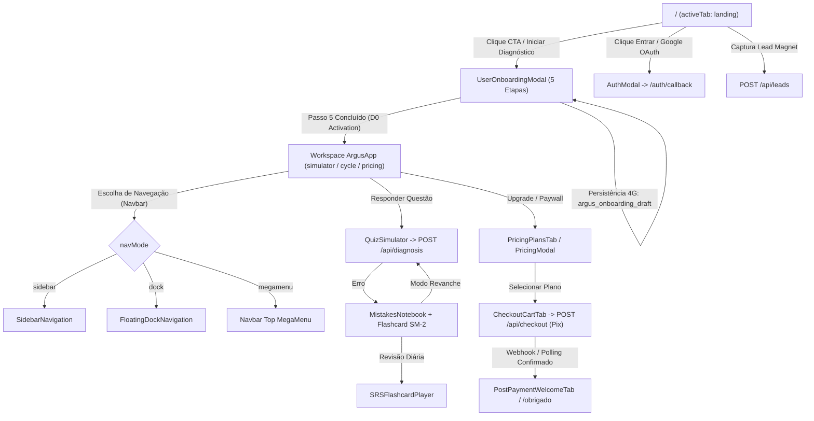

# 03 — Fluxo do App, Telas & Mapa de Interações — Argus

> **Documento 03 de 06 — Blueprint Fundacional do Produto**  
> **Escopo:** Inventário de todas as rotas, modais e abas do workspace, e o comportamento determinístico de cada clique e transição de estado.  
> **Arquivos de Origem Verificados:** [`ArgusApp.tsx`](../../src/components/ArgusApp.tsx) • [`SidebarNavigation.tsx`](../../src/components/SidebarNavigation.tsx) • [`FloatingDockNavigation.tsx`](../../src/components/FloatingDockNavigation.tsx) • [`middleware.ts`](../../src/middleware.ts)

---

## 1. Mapa de Rotas (Next.js App Router)

| Rota | Arquivo | Tipo / Acesso | Função |
| :--- | :--- | :--- | :--- |
| `/` | `src/app/page.tsx` | Pública (SPA Shell) | Carrega `ArgusApp` (Landing + Workspace completo controlado por `activeTab`). |
| `/edital/[slug]` | `src/app/edital/[slug]/page.tsx` | Pública (SEO Programático) | Página específica por concurso/edital para captação orgânica e formulário de leads (`POST /api/leads`). |
| `/auth/callback` | `src/app/auth/callback/page.tsx` | Pública (Auth Callback) | Recebe retorno do Supabase Auth (Google OAuth / Magic Link OTP) e conclui sessão. |
| `/obrigado` | `src/app/obrigado/page.tsx` | Pós-Checkout | Página de confirmação pós-pagamento e direcionamento ao onboarding/plataforma. |
| `/privacidade` | `src/app/privacidade/page.tsx` | Legal / Pública | Política de Privacidade e conformidade LGPD. |
| `/termos` | `src/app/termos/page.tsx` | Legal / Pública | Termos de Uso e diretrizes de direitos autorais / takedown. |
| `/admin`, `/dashboard`, `/app`, `/study`, `/simulado` | Interceptadas em `src/middleware.ts` | Protegidas (Middleware) | `/admin` exige token JWT (redirect `/?auth=required`); demais rotas exigem assinatura/trial válido (redirect `/?paywall=required`), salvo variante B do experimento `freemium_vs_paid_experiment`. |

---

## 2. Diagrama Geral de Fluxo (D0 até Loop Diário de Estudo)

---

## 3. Fluxo de Onboarding em 5 Etapas (`UserOnboardingModal.tsx`)

Baseado em `specs/PRD-02-onboarding-activation.md` e nas **7 Leis de UX**:

| Etapa | Tela / Decisão Única | Ação do Clique & Persistência |
| :--- | :--- | :--- |
| **Etapa 1** | **Mapeamento da Dor Estrutural** (`PAIN_POINTS`: `pegadinhas`, `tempo`, `estagnado`, `esquecimento`) | Seleciona 1 dor principal -> salva em `localStorage` (`argus_onboarding_draft`) -> habilita avanço imediato. |
| **Etapa 2** | **Concurso & Banca Alvo** (`POPULAR_TARGETS` ou concurso customizado sanitizado) | Seleciona cargo/banca -> calibra o edital e questões padrão do usuário. |
| **Etapa 3** | **Matéria "Calcanhar de Aquiles"** | Identifica a disciplina crítica para priorização inicial no ciclo. |
| **Etapa 4** | **Escolha do Animal Guardião** (`coruja`, `lobo`, `gaviao`, `leao`, `raposa`, `onca`, `fenix`) + *Goal-Gradient (`>= 75%`: microcopy motivacional)* | Define arquétipo em `StudentProfile.guardianAnimalId` e `warName` (`WAR_NAME_MAX_LENGTH`). |
| **Etapa 5** | **Passaporte de Estudos & Veredito** | Limpa rascunho (`clearOnboardingDraft`), grava perfil (`argus_onboarding_profile`, `argus_onboarding_completed`), dispara boas-vindas se aplicável e direciona direto para `simulator`, `cycle` ou `pricing` — **zero tela em branco**. |

---

## 4. Mapa de Telas, Abas & Ações por Clique (`ArgusApp.tsx`)

### 4.1. Núcleo de Estudo & Execução Diária (Pilares Principais)

| `activeTab` | Componente Renderizado | O que acontece em cada clique / interação principal |
| :--- | :--- | :--- |
| `landing` | `LandingPage` | Hero, Psicometria, Metodologia, Features, Lead Capture (`POST /api/leads`), Planos. Cliques nos CTAs abrem `UserOnboardingModal`, `AuthModal` ou saltam para `simulator`/`pricing-plans`. |
| `dashboard` / `analytics` | `AnalyticsDashboard` | Exibe acurácia global, tempo de estudo, heatmap de consistência (`ConsistencyHeatmap`), alinhamento por banca e previsão de corte. Clique em lacunas leva ao `simulator` ou `mistakes`. |
| `simulator` | `QuizSimulator` | Clique no ícone de tesoura risca distrator (`opacity-40`, sem submeter); `A-/A+` ajusta fonte; clique em alternativa + **Confirmar** chama `POST /api/diagnosis` e abre comentário legal inline (`codeCitation`), armadilha da banca e micro-auditoria; erro gera entrada no Caderno de Erros e card SM-2. |
| `mistakes` | `MistakesNotebook` | Lista erros não superados; clique em **Anotar** salva `userPersonalNote`; clique em **Modo Revanche** abre questão para refazer; ao acertar, alterna `isOvercome = true`. |
| `flashcards` | `SRSFlashcardPlayer` | Clique no cartão vira frente/verso (3D flip); clique nos botões de qualidade SM-2 recalcula `intervalDays`, `repetitions`, `easeFactor` e `nextReviewDate`. |
| `vademecum` | `SmartVadeMecum` | Filtro/busca por lei/artigo ou banca exibe artigos mais cobrados e súmulas relacionadas. |
| `psychometrics` | `BancaPsychometrics` | Gráficos `Recharts` e matriz TRI mostrando taxa de incidência de pegadinhas semânticas por banca. |

### 4.2. Planejamento, Edital & Produção Textual (Módulos de Preparação)

| `activeTab` | Componente Renderizado | O que acontece em cada clique / interação principal |
| :--- | :--- | :--- |
| `edital` | `EditalParser` | Seleção de edital pré-carregado ou envio para `POST /api/edital` / fila assíncrona (`POST /api/edital/jobs`, polling `GET /api/edital/jobs/[id]`); clique em **Gerar Ciclo** navega para `cycle`. |
| `cycle` | `StudyCycleManager` | Configura horas diárias e metodologia; gera grade de blocos (`DailyScheduleItem`); clique em iniciar bloco abre `simulator` filtrado na matéria. |
| `questions` | `QuestionBank` | Filtros combinados (`banca`, `subject`, `topic`, `year`, `difficulty`, `status`) consultam `GET /api/questions` e permitem resolver direto ou abrir no simulador. |
| `summaries` / `resumos` | `SmartSubjectSummaries` | Exibe resumos estruturados 80/20 por disciplina/tópico do edital ativo. |
| `discursivas` | `DiscursiveStudio` | Escolha do tema/peça OAB -> editor com contador de linhas -> **Enviar para Correção** (`POST /api/discursive`) -> exibe nota `0–100`, espelho por critério, erros linha-a-linha (`lineErrors`) e versão melhorada. |
| `radar` | `ConcursosRadarTab` | Lista concursos abertos/previstos com `BrazilInteractiveMap`, prazos e salários; clique em concurso permite adotá-lo como alvo no estudo. |

### 4.3. Monetização, Conta & Overlays Globais

| `activeTab` / Modal | Componente | Fluxo & Transição |
| :--- | :--- | :--- |
| `pricing-plans` / `PricingModal` | `PricingPlansTab` / `PricingModal` | Alterna faturamento Anual/Mensal, compara os 4 planos pagos (`lancamento`, `pro`, `elite`, `black`); clique no CTA seleciona plano e abre `checkout`. |
| `checkout` | `CheckoutCartTab` | Preenche dados -> **Gerar Pix** chama `POST /api/checkout` -> exibe QR Code e copia-e-cola Pix -> polling `GET /api/checkout?transactionId=...` -> ao confirmar via `POST /api/webhooks/payment`, navega para `welcome-success`. |
| `welcome-success` | `PostPaymentWelcomeTab` | Confirma desbloqueio do plano adquirido e conduz ao primeiro treino/edital. |
| `subscription` | `SubscriptionManagementTab` | Gerencia status atual, renovação (`/api/subscription/renewal-notice`) e cancelamento (aciona `PaidUserChurnModal` para retenção). |
| `settings` | `UserSettingsTab` | Preferências de tema (`light`/`dark`), modo de navegação (`sidebar`/`dock`/`megamenu`), notificações e dados do perfil. |
| `help` | `HelpAndAboutTab` | Guia da plataforma, FAQ e abertura de chamados (`/api/support`) ou takedown autoral (`CopyrightTakedownModal` -> `/api/compliance/takedown`). |
| **Gaveta IA (Global)** | `AICopilotDrawer` | Botão flutuante/header abre gaveta lateral em qualquer aba; envia pergunta para `POST /api/copilot` mantendo contexto da prova/questão atual. |
| **Admin Modal** | `AdminQuestionIngestModal` | Acessível apenas com sessão/permissão admin; envia questões estruturadas para `POST /api/admin/ingest-exam` (validado contra CSRF e token JWT). |

---

## 5. Regras de Navegação & Mobile Ergonomics

1. **Histórico de Abas (`handleNavigateWithHistory` / `handleGoBack`):** `ArgusApp.tsx` mantém até 15 abas em `tabHistory`, executando `window.scrollTo({ top: 0, behavior: 'smooth' })` a cada transição.
2. **Prevenção de Sobreposição em Mobile (`FloatingDockNavigation.tsx`):** A dock inferior detecta automaticamente overlays ativos no DOM (`[role="dialog"]`, `[aria-modal="true"]`, `.fixed.inset-0`) para ocultar-se quando um modal é aberto e não bloquear botões de confirmação.
3. **Sem Telas Mortas:** Toda conclusão de onboarding, pagamento ou erro tratado deve oferecer CTA primário claro (`>= 48px` de altura) para a próxima ação produtiva.
