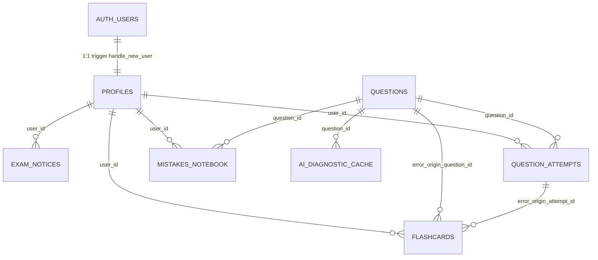

# 05 — Esquema do Back-end, APIs & Regras de Acesso (RLS) — Argus

> **Documento 05 de 06 — Blueprint Fundacional do Produto**  
> **Escopo:** Modelo relacional no PostgreSQL (Supabase), colunas, chaves estrangeiras, triggers de segurança, índices, políticas RLS exatas, mapa de API Routes e guardrails contra mutações destrutivas.  
> **Arquivos de Origem Verificados:** [`supabase/schema.sql`](../../supabase/schema.sql) • [`src/lib/guardrails.ts`](../../src/lib/guardrails.ts) • [`src/lib/supabaseService.ts`](../../src/lib/supabaseService.ts)

---

## 1. Extensões & Diagrama Entidade-Relacionamento (`supabase/schema.sql`)

- **Extensões habilitadas:** `uuid-ossp`, `vector` (pgvector para embeddings futuros), `pg_trgm` (busca textual fuzzy no enunciado de questões).

---

## 2. Tabelas, Colunas & Relacionamentos (`supabase/schema.sql`)

| Tabela | PK & Relações (FK) | Campos Principais | Finalidade |
| :--- | :--- | :--- | :--- |
| `public.profiles` | PK `id` (`UUID -> auth.users ON DELETE CASCADE`) | `full_name`, `email`, `target_exam`, `study_methodology`, `daily_hours_goal`, `streak_days`, `subscription_tier` (`aspirante` \| `pro` \| `elite` \| `black` \| `lancamento`), `subscription_status`, `avatar_animal`, `war_name`, `daily_ai_requests_count`, `daily_ai_requests_reset_at` | Perfil do candidato, gamificação, plano e consumo diário de IA. |
| `public.exam_notices` | PK `id` (`UUID`); FK `user_id -> profiles.id` | `title`, `institution`, `banca`, `role`, `salary`, `vacancies`, `exam_date`, `pdf_storage_path`, `parsed_data (JSONB)` | Editais enviados/verticalizados pelo usuário. |
| `public.questions` | PK `id` (`UUID`) | `subject_name`, `topic_name`, `banca`, `year`, `institution`, `statement`, `code_citation`, `options (JSONB)`, `explanation`, `law_articles (TEXT[])`, `cognitive_analysis (JSONB)` | Banco central compartilhado de questões. |
| `public.question_attempts` | PK `id` (`UUID`); FKs `user_id -> profiles.id`, `question_id -> questions.id` | `selected_option_id`, `is_correct`, `time_spent_seconds`, `error_type`, `ai_diagnostic (JSONB)`, `answered_at` | Histórico individual de resoluções e diagnóstico cognitivo. |
| `public.flashcards` | PK `id` (`UUID`); FK `user_id -> profiles.id`, ops `error_origin_attempt_id`, `error_origin_question_id` | `subject_name`, `topic_name`, `front`, `back`, `next_review_date`, `interval_days`, `repetitions`, `ease_factor` | Cartões SRS (algoritmo SM-2 / Ebbinghaus). |
| `public.mistakes_notebook` | PK `id` (`TEXT`); FKs `user_id -> profiles.id`, `question_id -> questions.id` | `user_personal_note`, `is_overcome`, `revanche_attempts_count`, `last_attempt_date`, `created_at`, `updated_at` | Caderno de Erros Ativo & Modo Revanche. |
| `public.ai_diagnostic_cache` | PK `cache_key` (`TEXT`); FK `question_id -> questions.id` | `selected_option_id`, `error_type`, `ai_diagnostic (JSONB)` | Cache persistente L2 para economia de tokens Gemini. |
| `public.leads` | PK `id` (`TEXT`) | `name`, `email`, `phone`, `target_edital` | Captação orgânica/SEO (`/edital/[slug]` e landing). |
| `public.transactions` | PK `id` (`TEXT`); FK ops `user_id -> profiles.id` | `user_id`, `plan_id`, `billing_cycle`, `amount`, `payment_method`, `status`, `pix_code`, `provider`, `user_email`, `external_id`, `confirmed_at`, `expires_at` | Checkout Pix (Asaas) e Stripe + vínculo imutável por `user_id`. |
| `public.webhook_events` | PK `event_id` (`TEXT`) | `provider`, `transaction_id`, `payload_summary (JSONB)`, `processed_at` | Idempotência persistente de webhooks resistente a cold starts Serverless. |
| `public.admin_allowlist` | PK `id` (`UUID`); FK ops `user_id -> auth.users.id` | `user_id`, `email`, `role` (`admin` \| `secops`), `is_active`, `created_at` | Allowlist server-only de administradores (nunca gravável por cliente). |
| `public.security_audit_logs` | PK `id` (`TEXT`) | `event_type`, `severity`, `source_ip`, `user_id`, `actor_email`, `route`, `details (JSONB)`, `created_at` | Logs append-only de segurança (SIEM persistente). |
| `public.rate_limit_counters` | PK `rate_key` (`TEXT`) | `request_count`, `reset_at` | Contadores distribuídos para RPC `increment_rate_limit`. |

### 2.1. Triggers de Integridade & Segurança
1. **`on_auth_user_created` -> `public.handle_new_user()`:** Cria automaticamente a linha correspondente em `public.profiles` após signup no Supabase Auth.
2. **`trg_protect_profile_subscription` -> `public.protect_profile_subscription_fields()`:** Em `BEFORE UPDATE ON public.profiles`, bloqueia qualquer alteração de `subscription_tier`, `subscription_status` ou manipulação indevida de `daily_ai_requests_count` quando a sessão não for `service_role`, `postgres` ou `supabase_admin`. Impede elevação fraudulenta de plano pelo client.

### 2.2. Índices de Performance (14 Índices Verificados)
- `idx_flashcards_user_review` `(user_id, next_review_date)`
- `idx_attempts_user_analytics` `(user_id, is_correct, answered_at DESC)`
- `idx_attempts_question` `(question_id)`
- `idx_mistakes_user_status` `(user_id, is_overcome, last_attempt_date DESC)`
- `idx_mistakes_question` `(question_id)`
- `idx_questions_banca_subject` `(banca, subject_name, year DESC)`
- `idx_questions_banca_trgm` `GIN (banca gin_trgm_ops)`
- `idx_questions_subject_trgm` `GIN (subject_name gin_trgm_ops)`
- `idx_questions_statement_trgm` `GIN (statement gin_trgm_ops)`
- `idx_cache_lookup` `(cache_key)`
- `idx_transactions_user_status` `(user_email, status)`
- `idx_transactions_external_id` `(external_id)`
- `idx_profiles_email` `(email)`
- `idx_exam_notices_user` `(user_id)`

---

## 3. Matriz de Regras de Acesso (Row-Level Security — RLS)

Todas as **13 tabelas** possuem `ENABLE ROW LEVEL SECURITY` ativo no `supabase/schema.sql`:

| Tabela | Política Aplicada (`supabase/schema.sql`) | Quem lê (`SELECT`) | Quem escreve (`INSERT` / `UPDATE` / `DELETE`) |
| :--- | :--- | :--- | :--- |
| `profiles` | `"Users can manage their own profile"` (`FOR ALL USING (auth.uid() = id)`) | Apenas o dono (`auth.uid() = id`) + `service_role` | Dono edita campos não protegidos; assinatura/quotas/role bloqueados pelo trigger `trg_protect_profile_subscription` (apenas `service_role`). |
| `exam_notices` | `"Users can manage their own editais"` (`FOR ALL USING (auth.uid() = user_id)`) | Apenas o dono (`auth.uid() = user_id`) | Apenas o dono (`auth.uid() = user_id`). |
| `question_attempts` | `"Users can manage their own attempts"` (`FOR ALL USING (auth.uid() = user_id)`) | Apenas o dono | Apenas o dono. |
| `flashcards` | `"Users can manage their own flashcards"` (`FOR ALL USING (auth.uid() = user_id)`) | Apenas o dono | Apenas o dono. |
| `mistakes_notebook` | `"Users can manage their own mistakes"` (`FOR ALL USING (auth.uid() = user_id)`) | Apenas o dono | Apenas o dono. |
| `questions` | `"Authenticated users can view questions"` (`TO authenticated USING (auth.uid() IS NOT NULL)`) + `service_role` | Usuários autenticados (`anon` bloqueado) + `service_role` | Exclusivo `service_role` / ingestão administrativa autenticada. |
| `ai_diagnostic_cache` | `"Authenticated users can read diagnostic cache"` (`TO authenticated USING (auth.uid() IS NOT NULL)`) + `"Service role manages diagnostic cache"` | Usuários autenticados (`anon` bloqueado) + `service_role` | `INSERT` / `UPDATE` / `DELETE` exclusivos `service_role` (bloqueia poisoning por anônimos/alunos). |
| `leads` | `"Public anonymous insert for leads"` (`FOR INSERT WITH CHECK (true)`) | Apenas `service_role` | Inserção anônima via formulário; gestão apenas backend. |
| `transactions` | `"Owner can view own transactions"` (`TO authenticated USING (auth.uid() = user_id)`) + `service_role` | Apenas dono (`auth.uid() = user_id`) ou `service_role` | Escrita exclusiva do backend via `service_role`. |
| `webhook_events` | `"Service role manages webhook events"` | Exclusivo `service_role` | Exclusivo `service_role`. |
| `admin_allowlist` | `"Service role manages admin allowlist"` | Exclusivo `service_role` | Exclusivo `service_role` / SQL Editor. |
| `security_audit_logs` | `"Service role manages security audit logs"` | Exclusivo `service_role` | Append-only exclusivo `service_role`. |
| `rate_limit_counters` | `"Service role manages rate limit counters"` | Exclusivo `service_role` | Exclusivo `service_role` / RPC `increment_rate_limit`. |

---

## 4. Inventário de API Routes (`src/app/api/`)

| Endpoint | Métodos | Função & Segurança |
| :--- | :--- | :--- |
| `/api/auth/login` | `POST` | Login via Supabase/mock; rate limit anti-brute-force (`10 req/min` por IP) e cookie de sessão. |
| `/api/auth/register` | `POST` | Cadastro de conta e disparo de criação de perfil. |
| `/api/auth/logout` | `POST` | Encerramento de sessão e limpeza de cookies. |
| `/api/auth/session` | `GET` | Validação de sessão ativa no backend (`isAdmin` somente via allowlist server-only) + renovação de cookie assinado `argus_user_access`. |
| `/api/auth/forgot-password` | `POST` | Recuperação de senha com Turnstile CAPTCHA + rate limit `3/min` e resposta neutra anti-enumeração. |
| `/api/auth/unsubscribe` | `GET`, `POST` | Cancelamento de comunicações de e-mail. |
| `/api/edital` | `POST` | Processamento e verticalização de edital por IA/catálogo. |
| `/api/edital/jobs` & `/api/edital/jobs/[id]` | `POST`, `GET` | Enfileiramento e consulta de jobs assíncronos de parsing (`src/lib/queue/jobManager.ts`). |
| `/api/questions` | `GET` | Consulta filtrada ao banco de questões. |
| `/api/diagnosis` | `POST` | Diagnóstico cognitivo de erro (Quota -> Cache L1/L2 -> Gemini -> Fallback). |
| `/api/copilot` | `POST` | Chat contextual do Tutor IA. |
| `/api/discursive` | `POST` | Avaliação estruturada de redações e peças OAB por critérios e linha-a-linha. |
| `/api/checkout` | `POST`, `GET` | Criação de cobrança Pix Asaas / transação e polling de status. |
| `/api/webhooks/payment` | `POST` | Processamento idempotente (`eventId`) Asaas (`asaas-access-token`) e Stripe (`stripe-signature`). |
| `/api/leads` | `POST`, `GET` | Captação e consulta de leads de landing pages. |
| `/api/welcome-email` | `POST` | Envio de e-mail de boas-vindas (Resend). |
| `/api/retention/inactivity-check` | `GET`, `POST` | Detecção e gatilho de recuperação de alunos inativos. |
| `/api/subscription/renewal-notice` | `GET`, `POST` | Aviso preventivo de renovação de assinatura. |
| `/api/support` | `GET`, `POST`, `PATCH` | Abertura e atualização de tickets de suporte. |
| `/api/compliance/takedown` | `GET`, `POST` | Solicitações de remoção autoral / DMCA / LGPD. |
| `/api/admin/ingest-exam` | `POST` | Ingestão administrativa de provas/questões (`assertServerAdmin`: JWT + allowlist servidor / `ADMIN_API_KEY` + CSRF). |
| `/api/admin/session` & `/api/admin/audit-logs` | `GET` | Verificação server-only de privilégio admin e consulta aos logs de auditoria SIEM (`security_audit_logs`). |

---

## 5. Guardrails Programáticos de Dados (`src/lib/guardrails.ts`)

Baseado em `specs/PRD-03-guardrails-data-safety.md`:
1. **Bloqueio de SQL destrutivo em `validateDatabaseGuardrail()`:** Rejeita `DROP TABLE`, `DROP DATABASE`, `DROP SCHEMA`, `TRUNCATE TABLE`, `ALTER TABLE ... DROP COLUMN`, `DELETE FROM ...` sem `WHERE` ou com `WHERE 1=1`.
2. **Entidades protegidas contra Hard Delete (`PROTECTED_ENTITIES`):** `questions`, `student_profiles`, `exam_notices`, `audit_logs`, `question_attempts`, `payment_transactions`. Exigem Soft Delete (`isDeleted = true` + `deletedAt`).
3. **Updates em massa (`WHERE 1=1`):** Exigem `confirmationToken` com prefixo `CONFIRM_BULK_`.

---

## 6. Auditoria de Escalabilidade para 1.000 Usuários Simultâneos (Skill `scale-load-testing-sla`)

| Camada | Estado Verificado no Repositório | Gargalo / Risco sob 100→1.000 VUs | Status / Implementação Aplicada |
| :--- | :--- | :--- | :--- |
| **Consultas & Índices SQL** | `supabase/schema.sql` agora define 14 índices (`idx_questions_banca_trgm`, `idx_questions_subject_trgm`, `idx_transactions_external_id`, `idx_profiles_email`, etc.). | Wildcards `%termo%` sem GIN/filtro exato anulavam B-Tree em `/api/questions`. | **Aplicado:** `src/app/api/questions/route.ts` usa filtro indexável `.ilike(col, valor)` sem `%...%`, combinado aos índices GIN `pg_trgm` em `banca` e `subject_name`. |
| **Cache Compartilhado ("1 consulta em vez de 1.000")** | `/edital/[slug]` (SSG), `/api/diagnosis` (L1+L2 `ai_diagnostic_cache`) e `/api/questions` (`src/lib/questionsCache.ts`). | Repetir `SELECT` em `/api/questions` sob 1.000 VUs saturava conexões. | **Aplicado:** Cache L1 compartilhado por `(banca, subject, limit)` (TTL 5 min) + `Cache-Control: public, s-maxage=300, stale-while-revalidate=600`. |
| **Alerta de Latência `> 1s`** | `src/lib/logger.ts` (`recordLatencySLA` / `measureLatency`). | Degradação progressiva (`> 1.000 ms`) sem alerta automático por endpoint. | **Aplicado:** Rotas críticas (`/api/questions`, `/api/diagnosis`, `/api/checkout`, `/api/copilot`) emitem `api_latency_ms` e `SLA_LATENCY_BREACH` se `durationMs > 1000`. |
